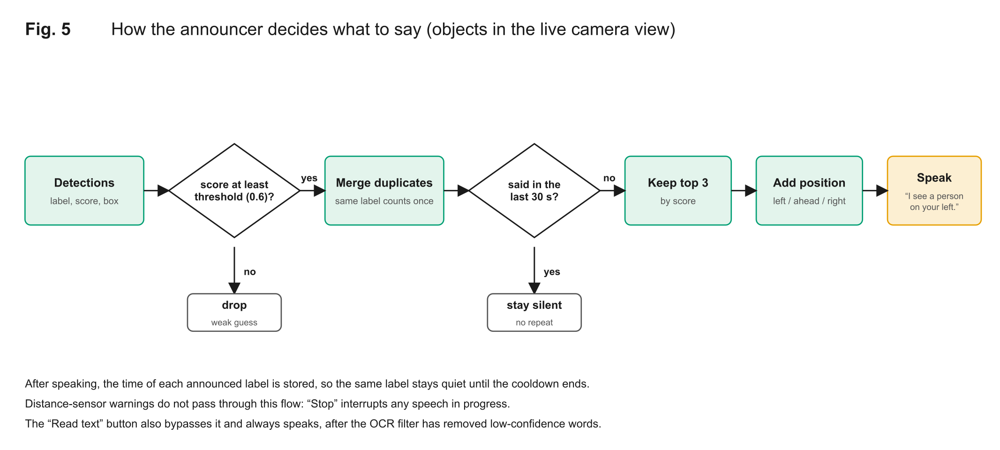
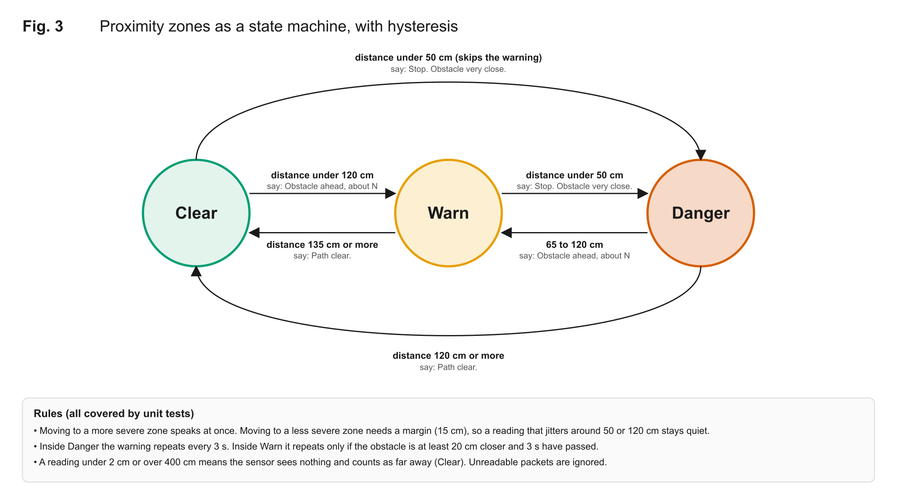
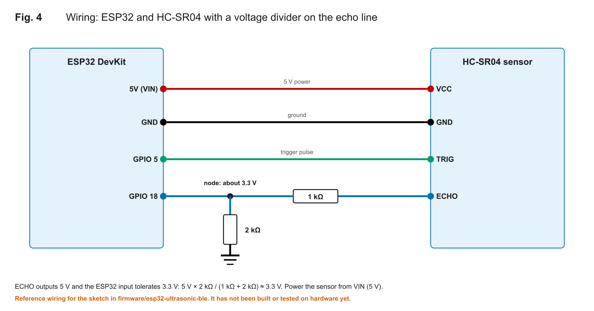

# IoT Blind Assistant

An on-device assistant that **describes what is in front of you, reads text aloud and warns about close obstacles**, built for visually impaired users. It runs in a browser on a phone or laptop: no account, no API key, no server, and no image leaves the device.

**Live app:** <https://waqasulhaqqureshi.github.io/iot-blind-assistant/> (open it in Chrome or Edge, tap *Start camera* or *Analyze a photo*)

> **Not a safety device.** This is a student project. Do not rely on it to cross a road or avoid hazards. Detection can miss or mislabel things, and the distance sensor cannot see soft, angled or thin obstacles.

## What it does

| Feature | How it works |
| --- | --- |
| **"I see a person on your left and a bus ahead."** | COCO-SSD object detection (80 everyday object classes) on TensorFlow.js. Each object is placed *left / ahead / right* from where it sits in the frame. |
| **"Text reads: EXIT. Push to open."** | Tesseract.js OCR on demand (button or key `R`), with a filter that drops low-confidence noise so garbage is never read aloud. |
| **"Stop. Obstacle very close."** | A distance sensor (ultrasonic, over Bluetooth) feeds warning zones with hysteresis, speech and vibration. A built-in simulator lets you try it without hardware. |
| **Calm speech** | A confidence threshold, a per-label cooldown and a three-object cap stop it from narrating every frame. Danger warnings interrupt; everything else queues without piling up. |
| **Battery saver** | A cheap frame-difference check skips the detector when the scene has not changed. An optional slower check interval and a screen wake lock while the camera runs. |
| **Accessible interface** | Large controls, high contrast, keyboard operable, a live status region, and a text log of everything spoken. |
| **Analyze a photo** | Works without a camera: pick a photo and hear what is in it. |

## How it works


*Figure 1. System overview. Everything inside the dashed box runs in the phone's browser. Dashed blocks (the Bluetooth link and the ESP32) have not been verified on hardware yet.*



*Figure 5. How the announcer decides what to say for objects in the live camera view. Weak guesses are dropped, repeats are suppressed, and at most three objects are spoken, each with where it is.*

The decision logic (what to say and when) is plain JavaScript with no browser dependencies, so it is unit-tested in Node. Details are in [ARCHITECTURE.md](ARCHITECTURE.md).

## What was tested, and what was not

Verified on 2 November 2026 (Chromium-based browser, local server):

| Check | Result |
| --- | --- |
| Object detection on a street photo | Found `person` (99%) on the left and `bus` (94%) ahead; second person merged into the first sentence |
| OCR on a clear sign | Read `EXIT PUSH TO OPEN` exactly |
| OCR on a real photo | Read printed words on the bus (`emisiones`) and dropped single-letter noise |
| Live camera loop | Fed a synthetic video stream through the real start/stop path: started, detected, announced, idled in battery-saver mode, stopped cleanly |
| Distance simulator | Warn, danger, clear, and hysteresis behave as designed; the badge changes colour |
| Hosted copy on GitHub Pages | Loaded TensorFlow.js (WebGL), the detector and the OCR engine, and read a drawn sign correctly; the service worker registered and cached 24 files |
| Unit tests | 33 tests for the announcer, proximity zones, scene-change check and OCR filter (`npm test`, also run in CI) |

**Not verified yet** (be careful before relying on these):

- A real webcam on a real phone, outdoors, while walking
- The Bluetooth link and the ESP32 firmware: the sketch in `firmware/` has **not** been compiled or flashed
- Loading the app with the network switched off: the service worker registers and caches files, but I did not test an offline reload
- Screen-reader and TalkBack testing, and any testing with blind or low-vision users
- Measured latency, accuracy and battery drain: no numbers are published because none were collected

The protocol for collecting those numbers on a real phone, and a results table that is still empty, are in [FIELD_TEST.md](FIELD_TEST.md).

## Run it

```bash
git clone https://github.com/waqasulhaqqureshi/iot-blind-assistant.git
cd iot-blind-assistant
npm test        # unit tests, Node 20+, no dependencies
npm start       # serves the app at http://localhost:3000 (needs internet the first time)
```

The camera, speech and Bluetooth need a secure context: `https://` or `http://localhost`. The first load downloads several megabytes (TensorFlow.js, the detector model, the OCR engine and its language data) from public CDNs; after that the browser caches them. I have not measured the exact size.

## Distance sensor (optional hardware)

An ESP32 with an HC-SR04 ultrasonic sensor sends `D:<cm>` packets over Bluetooth LE using the Nordic UART service; the web app parses them. Wiring and the sketch are in [`firmware/esp32-ultrasonic-ble`](firmware/esp32-ultrasonic-ble/esp32-ultrasonic-ble.ino).

- Web Bluetooth works in Chrome and Edge on Android and desktop. **iPhone/Safari does not support it**; the simulator and everything else still work.
- The HC-SR04 `ECHO` pin is 5 V; the ESP32 is 3.3 V, so use a voltage divider.
- Zones: closer than 50 cm is *danger*, closer than 120 cm is *warning*, with a 15 cm hysteresis margin so jitter does not flip the message.


*Figure 2. Sensing zones around the wearer (top view, schematic, not measured data).*



*Figure 3. The proximity zones as a state machine. Leaving a zone needs a 15 cm margin, which is why a reading that jitters around a threshold stays quiet.*



*Figure 4. Reference wiring. The divider brings the 5 V echo signal down to about 3.3 V for the ESP32. This wiring has not been built or tested yet.*

## Privacy

- Camera frames are analysed in the browser. No image or audio is uploaded, and there are no analytics or accounts.
- The first load fetches scripts and model files from jsDelivr and Google storage, so those hosts can see your IP address. Settings are stored in your browser's local storage.

## History: what this started as

This began as an IoT subject project during my BS Information Technology at Ghazi University: a wearable that used a camera, OpenCV, Google Cloud Vision and text-to-speech, with a mobile-app bridge for the microcontroller's sensors. The original course code is **not** published here. In 2026 I rebuilt the idea as this fully on-device web version so it works offline, costs nothing to run and can be tried by anyone. The rebuilt code was written with an AI coding assistant and tested with the checks listed above; the course prototype was my own work. I disclose this so nobody mistakes one for the other.

## Roadmap

1. Test on real phones outdoors and measure latency, accuracy and battery use
2. Compile and flash the firmware; verify the Bluetooth link end to end
3. Add an on-device OpenCV preprocessing step (contrast, deskew) before OCR
4. Test with blind and low-vision users and tune thresholds from their feedback
5. A "describe the scene" voice command and an Urdu speech option

## Built with

[TensorFlow.js](https://github.com/tensorflow/tfjs) and the [COCO-SSD model](https://github.com/tensorflow/tfjs-models/tree/master/coco-ssd) (Apache-2.0), [Tesseract.js](https://github.com/naptha/tesseract.js) (Apache-2.0), the Web Speech, Web Bluetooth and Vibration APIs.

## Author

Waqas Ul Haq Qureshi, [heywaqas.live](https://heywaqas.live)
